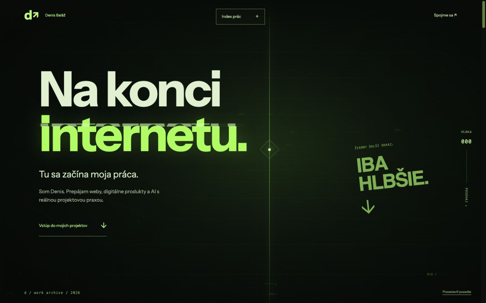

# Denis Baláž — portfólio

Osobné portfólio spájajúce weby, digitálne produkty a pracovné postupy s AI so skúsenosťou z prípravy a implementácie grantových projektov.



## Pracovná činnosť

Dve hlavné kapitoly priamo na stránke. Natívne posúvanie ovláda súvislé GSAP scény; text zostáva v HTML a dostupný aj bez animácií.

- **Tvorba webov:** päť krokov Štýlového chlpáča od rozhovoru cez vizuál, spoločný katalóg a rezervácie po spustenie na [stylovychlpac.sk](https://stylovychlpac.sk/). Verejné online objednávanie čaká na doplnenie kalendára salónom.
- **Príprava a implementácia eurofondov:** zámer, žiadosť a rozpočet, implementácia, konkrétna skúsenosť. Vizuály používajú ilustrované podklady, nie súkromné dokumenty.
- **[Zákazko.sk](https://zakazko.sk/):** kratšia nadväzujúca ukážka vlastného produktu pre cenové ponuky, zákazkové listy a preberacie protokoly.

Grantové referencie opisujú moju úlohu v tímovej práci. Sumy podpory patria prijímateľom; schválenie a zmluva sa odlišujú od dokončenej realizácie. Súkromné projektové dokumenty a e-maily v repozitári nie sú.

## Spustenie

Potrebuješ Node.js 24.15 alebo novší a npm.

```sh
npm ci
npm run dev
```

Vývojový server: http://127.0.0.1:8793/.

```sh
npm run check
npm run preview
```

`check` spustí kontrolu formátovania, ESLint, testy a produkčný build. Náhľad výsledného buildu je na http://127.0.0.1:8794/.

## Architektúra

HTML a bežný JavaScript s modulmi, CSS, GSAP a Vite. Celý obsah a kroky projektových príbehov zostávajú v HTML. Jedna časová os na kapitolu vlastní všetky transformácie scény. Funkcie vracajú cleanup pre bezpečné opätovné spustenie pri vývoji.

```text
index.html                 Obsah a sémantická štruktúra
src/main.js                Zostavenie jednotlivých funkcií
src/features/              Navigácia, kontakt, vstupné animácie, scrollové príbehy
src/styles/                Základné, sekčné a responzívne štýly
public/                    Obrázky, fonty, favicon a licenčné oznámenia
tests/                     Funkčné testy v simulovanom DOM
docs/                      Architektúra a vizuálny náhľad
.openai/hosting.json       Konfigurácia hostingu Sites
```

`dist/` je generovaný výstup príkazu `npm run build` a nie je verzovaný. Vite používa relatívne cesty, aby výsledok fungoval aj v podpriečinku. Podrobnosti sú v [architektúre](docs/architecture.md).

## Overovanie

Vitest a jsdom overujú mobilnú navigáciu, kopírovanie kontaktu vrátane zamietnutého prístupu a obojsmerný priebeh oboch časových osí. Rozloženie, kotvy, mobilná kompozícia a scroll sa kontrolujú samostatne v skutočnom prehliadači. Na výslovné zadanie majiteľa sú animácie na tomto portfóliu automaticky aktívne aj pri systémovom obmedzení pohybu. Nastavenia počítača sa nemenia.

GitHub Actions pri pushi a pull requeste spúšťajú rovnaký `npm run check`. Výsledok lokálnych kontrol a výsledok CI sú oddelené.

## Vizuál, AI a licencie

Na návrhu, textoch, implementácii a overovaní spolupracujem s AI. Vlastný ilustračný ostrov vznikol pomocou OpenAI image_gen. Pohyb zabezpečujú CSS a GSAP. Scény reagujú na posúvanie bez nutnosti klikať medzi krokmi.

Inšpiráciou pre hravý priestor a farebnosť bol Tatrascool; jeho logo, maskot ani assety sa nepoužívajú. Interaktívny príbeh Štýlového chlpáča používa vlastnú ilustrovanú scénu a fotografiu z jeho verejného webu; nejde o živú administráciu ani zákaznícke údaje. Obsah zostáva dostupný v HTML a dá sa prechádzať klávesnicou.

Instrument Sans používa SIL Open Font License; znenie je v `public/licenses/InstrumentSans-OFL.txt`. GSAP a ScrollTrigger používajú [vlastnú licenciu](https://gsap.com/standard-license/). Licencie knižníc sa nemenia. Pôvod assetov je v `ASSET-SOURCES.json`.

## Kontakt

Denis Baláž · denisbalaz965@gmail.com · +421 948 835 138
