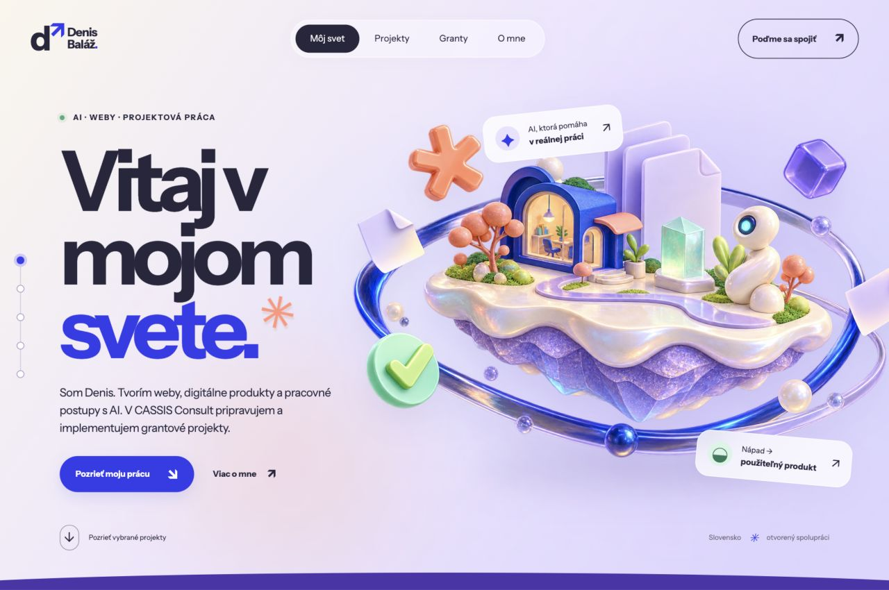

# Denis Baláž — portfólio

Osobné portfólio spájajúce weby, digitálne produkty a pracovné postupy s AI so skúsenosťou z prípravy a implementácie grantových projektov.



## Vybraná práca

- **Eurofondy s podporou AI:** používaný postup spracovania projektových podkladov, úloh a čakaní. Interaktívna ukážka používa modelové údaje.
- **Štýlový chlpáč:** návrh a realizácia webu pre psí salón, služby, cenník a rezervačný postup. Pripravuje sa na zverejnenie.
- **[Zákazko.sk](https://zakazko.sk/):** vlastný produkt pre cenové ponuky, zákazkové listy a preberacie protokoly.

Grantové referencie opisujú moju úlohu v tímovej práci. Sumy podpory patria prijímateľom; schválenie a zmluva sa odlišujú od dokončenej realizácie. Súkromné projektové dokumenty a e-maily v repozitári nie sú.

## Spustenie

Potrebuješ Node.js 24.15 alebo novší a npm.

```sh
npm ci
npm run dev
```

Vývojový server: http://127.0.0.1:8793/.

```sh
npm run check
npm run preview
```

`check` spustí kontrolu formátovania, ESLint, testy a produkčný build. Náhľad výsledného buildu je na http://127.0.0.1:8794/.

## Architektúra

HTML a bežný JavaScript s modulmi, CSS, GSAP a Vite. Obsah stránky zostáva v HTML; projektové príbehy a kroky ukážky majú samostatné dátové súbory. Funkcie vracajú cleanup pre bezpečné opätovné spustenie pri vývoji.

```text
index.html                 Obsah a sémantická štruktúra
src/main.js                Zostavenie jednotlivých funkcií
src/data/                  Príbehy projektov a kroky ukážky
src/features/              Navigácia, filtre, detaily, workflow, kontakt, animácie
src/styles/                Základné, sekčné a responzívne štýly
public/                    Obrázky, fonty, favicon a licenčné oznámenia
tests/                     Funkčné testy v simulovanom DOM
docs/                      Architektúra a vizuálny náhľad
.openai/hosting.json       Konfigurácia hostingu Sites
```

`dist/` je generovaný výstup príkazu `npm run build` a nie je verzovaný. Vite používa relatívne cesty, aby výsledok fungoval aj v podpriečinku. Podrobnosti sú v [architektúre](docs/architecture.md).

## Overovanie

Vitest a jsdom overujú navigáciu, filtre, všetky projektové detaily, zatvorenie a návrat fokusu, kroky workflow a správanie kontaktu pri povolenom aj zamietnutom kopírovaní. Tieto testy nenahrádzajú skutočný prehliadač: rozloženie, natívny dialóg a animácie sa overujú aj vizuálne na desktope a mobile.

GitHub Actions pri pushi a pull requeste spúšťajú rovnaký `npm run check`. Výsledok lokálnych kontrol a výsledok CI sú oddelené.

## Vizuál, AI a licencie

Na návrhu, textoch, implementácii a overovaní spolupracujem s AI. Vlastný ilustračný ostrov vznikol pomocou OpenAI image_gen. Pohyb zabezpečujú CSS a GSAP. Animácie sa spúšťajú automaticky bez ovládača podľa zadania portfólia.

Inšpiráciou pre hravý priestor a farebnosť bol Tatrascool; jeho logo, maskot ani assety sa nepoužívajú. Screenshot Štýlového chlpáča pochádza z vývojovej verzie projektu.

Instrument Sans používa SIL Open Font License; znenie je v `public/licenses/InstrumentSans-OFL.txt`. GSAP a ScrollTrigger používajú [vlastnú licenciu](https://gsap.com/standard-license/). Licencie knižníc sa nemenia. Pôvod assetov je v `ASSET-SOURCES.json`.

## Kontakt

Denis Baláž · denisbalaz965@gmail.com · +421 948 835 138
